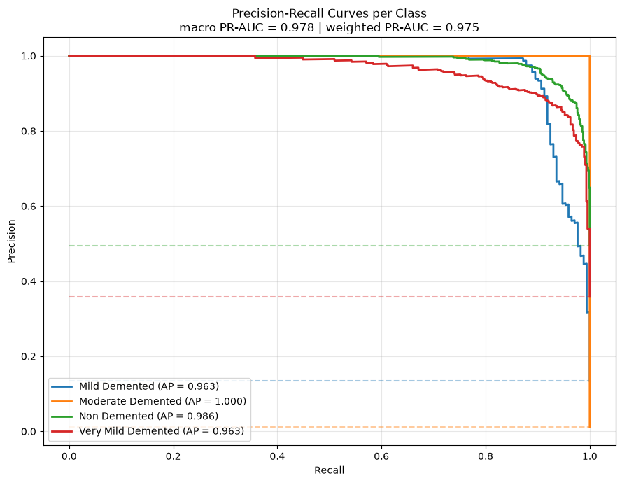
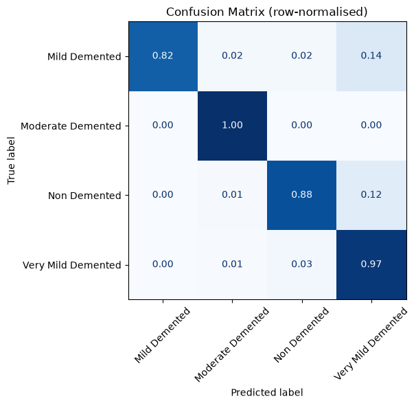
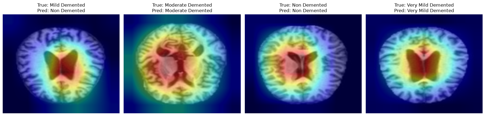
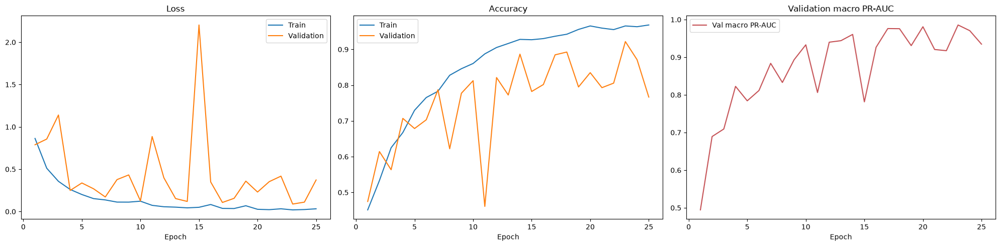

# Alzheimer's Disease Classification from Brain MRI

Deep learning classifier that stages Alzheimer's disease from 2D brain MRI slices into four classes, built with PyTorch by fine-tuning an ImageNet-pretrained **ResNet-18**. Beyond accuracy, the project adds a clinically oriented evaluation layer: Grad-CAM explainability, probability calibration, sensitivity-driven decision thresholds and MC-Dropout uncertainty.

Final project for **SCC0270 Neural Networks and Deep Learning** at the University of São Paulo (USP), 2026.

**Video presentation (Portuguese):** https://www.youtube.com/watch?v=e63AEgyk1r4

## Results

Evaluated on the held-out test split (1,280 images never used for training or model selection). The project's target metric is the **area under the Precision-Recall curve (PR-AUC)**, chosen because the classes are heavily imbalanced.

| Metric | Test score |
|---|---|
| **Macro PR-AUC** | **0.978** |
| Weighted PR-AUC | 0.975 |
| Macro ROC-AUC (one-vs-rest) | 0.988 |
| Accuracy | 0.902 |
| Balanced accuracy | 0.916 |
| Macro F1 | 0.860 |
| Matthews correlation (MCC) | 0.846 |
| Cohen's kappa | 0.841 |

Temperature scaling reduced the Expected Calibration Error from **0.043 to 0.009**.

<p align="center">
  
  
</p>

**Grad-CAM** heat maps show which regions drove each prediction. The model attends mostly to the ventricles and surrounding tissue, where atrophy-related enlargement appears:

<p align="center">
  
</p>

## Dataset

[Falah/Alzheimer_MRI](https://huggingface.co/datasets/Falah/Alzheimer_MRI) on Hugging Face: 6,400 axial MRI slices in four classes.

| Class | Train images |
|---|---|
| Non Demented | 2,566 |
| Very Mild Demented | 1,781 |
| Mild Demented | 724 |
| Moderate Demented | 49 |

The original training split was divided 80/20 into train and validation with stratification, and the original test split was kept untouched for the final evaluation.

## Approach

1. **Pre-processing:** resize to 176x208 (keeps the aspect ratio of the scans), grayscale, normalisation. Transforms are applied lazily per batch.
2. **Augmentation (training only):** horizontal flip, rotations up to 15 degrees and light random zoom.
3. **Model:** ImageNet-pretrained ResNet-18. The first convolution was changed to one input channel and initialised with the mean of the pretrained RGB filters, so the learned low-level features are kept. A new head with dropout 0.5 outputs the four classes.
4. **Class imbalance:** Focal Loss (gamma = 2) weighted by inverse class frequency. No oversampling on top of it, since combining both over-corrects and hurts recall on the majority class.
5. **Training:** AdamW (lr 3e-4), gradient clipping, learning-rate reduction on plateau and early stopping, all driven by validation macro PR-AUC.
6. **Clinical evaluation layer:**
   - Grad-CAM over the last residual block
   - Temperature scaling with a reliability diagram and ECE
   - Per-class decision thresholds tuned for at least 95% sensitivity
   - MC-Dropout predictive entropy to flag uncertain cases for human review
   - Optional stratified 5-fold cross-validation

<p align="center">
  
</p>

## Limitations

- **Possible data leakage.** This dataset is derived from a Kaggle collection that contains augmented near-duplicate images and is **not split by patient**. Scores are likely optimistic. The perfect score on the Moderate class, which has only 15 test images, is a clear warning sign.
- **2D slices only.** Volumetric hippocampal atrophy, the most consistent MRI biomarker of Alzheimer's, is lost. A 3D CNN over full NIfTI volumes would be the next step.
- **No clinical metadata** (MMSE, age, APOE genotype). The notebook includes an untrained architecture sketch for multimodal fusion that would apply to datasets such as ADNI.

This is an academic project and is not intended for clinical use.

## How to run

```bash
git clone https://github.com/VictorSilBot/alzheimer-mri-classification.git
cd alzheimer-mri-classification
pip install -r requirements.txt
jupyter notebook Alzheimer_Disease_Classification.ipynb
```

A GPU is strongly recommended. See the notes in `requirements.txt` to install the CUDA build of PyTorch. The notebook also runs on Google Colab. The dataset downloads automatically from Hugging Face. Logging in is optional: set the `HF_TOKEN` environment variable if you hit API rate limits.

The notebook explanations are in Portuguese. The code is in English.

## Authors

- Amanda Bezerra da Costa
- Arthur Araújo
- Arthur Filliettaz
- Victor Silva Botelho
